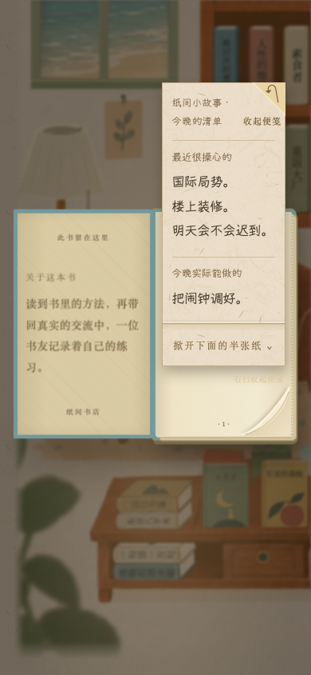
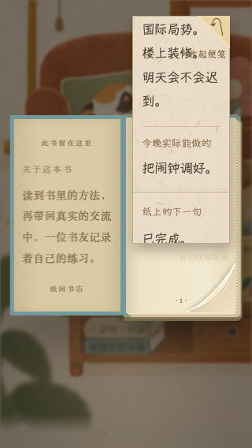
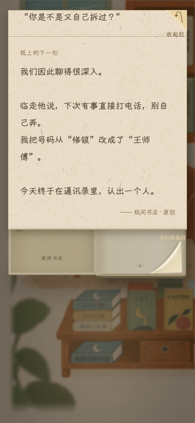

# 两批原创小故事接入 · humor-v1

日期：2026-10-23。现有 `paper-bookshop-playtest` 工程，`feat/rhythm-v014` 开发分支。本轮没有推送、部署或更改生产。入口：<http://127.0.0.1:4173/?playtest=rhythm&stories=humor-v1>。`stories=humor-v1`仅便于辨认本批入口，不是独立开关或历史快照；普通/rhythm/discovery入口均有本批。旧revisit专用样本保持。

## 交付与规则

- 新增14组、18张原创纸、11本书：8组短惊喜、3组较长参与、3组跨书探索。全部正文在 `stories.js`；[分布清单](../../ORIGINAL-STORIES.md)；[采集及美术要求](../../素材采集要求.md)。
- 复用便笺/接力信/钢笔/单右下角翻页与轻收纸。短故事末句随展开才出现；纸面用中性标题，内部故事标题仅作索引，避免提前泄露结尾。长信完全展开后可自愿接一句。跨书文本线索允许任何顺序发现。
- 原创纸显示“纸间小故事”，末段署“纸间书店 · 原创”，不伪造昵称、历史日期与原著引文。现有44条真实群聊及已核对的左页引文源码未改。原创纸没有核实配对原文，左页显示简介。
- 静态新纸按稳定ID增量合并。预写正文折段单独记`storyParts`；旧`replies`仍只记录玩家回应。未读完的开场保持；读完并归架后允许再抽。无45分钟等待、3张总量上限、强制路线。《猫的来信》与旧明信片/玫瑰/预设接力信保留。
- 本批不新增图片。清单用窄屏上下/宽屏左右的文字排版；《百年孤独》关系草图列ART-03待用户同步，目前是完整文字故事，没有伪装成可操作图。回应仍为本机保存，不新增共享服务。

## 测试过程与结果

| 阶段 | 结果 | 说明 |
| --- | --- | --- |
| 初轮新内容 | 8/10 | 两个失败来自测试忽略“自己的旧便笺有新回应优先”，误把首张当成故事，等待不存在的折段；未更改这一产品优先级 |
| 目标纸定位修正 | 2/2 | 测试先用实际页角翻到指定故事，再验证回应 |
| 新内容与兼容 | 148/148 | Chromium/WebKit，320×568和390×844；新故事20项及旧日期/原文/便笺/开场刷新/单页角/S1–S4/玫瑰兼容；0失败、跳过、flaky |
| A/B发现模式增补 | 4/4 | 原创纸进入discovery；A读完与B只开一段的进度相互独立 |
| 画面复看后中性标题 | 24/24 | 调整标题避免先泄露笑点后，重新跑完整6项原创用例×4项目；0失败、跳过、flaky。没有声称最终重跑148项旧用例 |
| 发现引擎 | 12/12 | 既有Node测试，全通过 |
| 最终Chromium CDP触摸 | 320/390各完整流程通过 | 全部真实/原创池加载，只有开场抽签作确定性种子；正常动画；原生触摸协议，两个上下文页面错误均为空 |

旧精确数据夹具明确stub空的`stories.js`，用于验证旧的纸数/排序，不在游戏运行代码里禁用故事。`authored-stories.spec.cjs`始终使用完整真实池及全部原创池，逐页验证18张均能到达，实际展开正文，检查来源标识/日期/简介，验证残余折段、原档和回应/草稿、三个跨书链及读者隔离。S3回归通过明确识别旧预设接力信，避免把新原创长信误当旧玩法。

新内容/原文/存档等11个运行文件在最终24项及最终CDP检查前后SHA256一致，HTTP字节匹配，见[source-hashes.json](source-hashes.json)。此前148项期间本任务这些脚本未修改，但并行猫/书架/地球仪工作有变化；不声称全工程或所有静态资源是同一冻结快照。源码语法、JSON与`git diff --check`通过。原44条/书籍资料/发现引擎相对本轮HEAD无代码改动。

完整JSON、日志、失败trace、前期截图和视频留在本机 `evidence/authored-stories/`。最终JSON为`final-stories.json`，兼容JSON为`compatibility.json`，CDP原始轨迹为`native-results.json`；关键截图与轨迹摘要随本报告提交。

## 实际自动操作轨迹

这是独立浏览器中的定向回归，**不是不知道目标的十分钟盲测，也不是实体iPhone/Safari/真实输入法验收**。WebKit用Playwright手机视口点击/触屏tap；Chromium额外用CDP输入真实touch事件序列。保存测试文字来自隔离存档，不操作用户正在看的标签与便笺。

1. 从藏书抽屉打开《七个习惯》，点封面，展开“今晚的清单”，窄纸清单上下排列；再掀开后半张读到最后一句。
2. 信纸仍打开时直接触摸右下角，先收纸再去下一页，没有要求额外点“折好”。Escape归架。
3. 打开《一句顶一万句》，取“通讯录里的一通电话”，逐段展开至第三段，才出现“接着写一句”；再由书角直接下一页。
4. 先去《四千周》读“读书准备的后记”，无需先读《百年孤独》或《笔记的方法》，结尾可以先被发现；合纸后继续用右下角真实touch拖翻页。
5. 自动化另走：长信只展开两段→归架→刷新→仍原纸两段→读完归架→允许新抽；写回应草稿→直接下一页→翻回原纸→草稿恢复→放回一次→刷新，旧便笺、旧回应、旧草稿均保留，故事回应只新增一条，原预设接力信不混写。

时间戳/视频定位在[touch-trajectory.json](touch-trajectory.json)。截图是隔离模拟浏览器实际渲染，不是美术设计稿。

## 待用户验收

实际手机上的文字大小、长信滚动和轻收纸手感；笑点/温度是否适合书店；ART-03关系草图的形式与剧透范围。当前无需补美术也能体验全部故事。后续新批次依采集文档审阅，不把原创对白并入真实群聊，不覆盖旧档。
