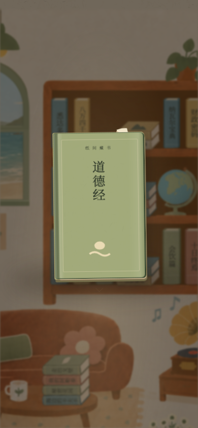
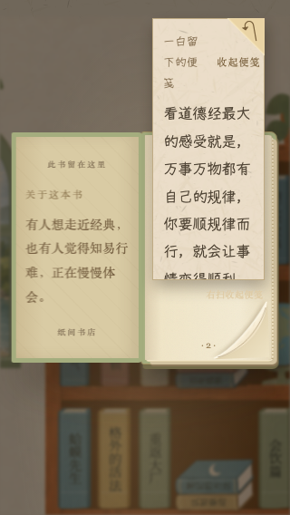

# 夹页纸角与书的连续呈现

2026-10-23，现有开发分支 `feat/rhythm-v014`。入口：<http://127.0.0.1:4173/?playtest=rhythm>，原用户标签未操作，刷新即可加载本地修改；未推送/部署。

## 修改效果

- 原先15×29px带边框的大纸签挂在`.spine:after`上；书面隐藏后，纸签仍可能留在书架空位。改为书面内的小暖米折角，薄纸边/柔影，尺寸随书面缩放，书摞单独适配横放比例；不再盖住大段书名。
- 纸角与实际书面同属一物件：书面隐藏时一起隐藏。拿起后的纸角挂在`.sid-carrier`中，继承竖书/横书的平移、缩放、旋转和归架动画，露在放大书的上缘；不漂在书外的界面角落。复用同一矢量轮廓，无新增外部美术资源。
- 封面展开时随原封面进度平滑收隐，接着显示实际夹页，不叠两个提示。关闭封面反向恢复。纸角不拦截触摸，不增加按钮、确认或翻书步骤；没有提示的下一本书不会残留上一张纸角。
- 新纸/回应的提示判定、原44条群聊、原创18张纸、旧档/草稿/已读、单右下角翻页保持。原《悉达多》独立的永久三角形装饰由同一规则覆盖，避免重复纸角。通知确认后是否继续显示依旧由原`has-new-paper`判定，未把打开封面记成已读。

## 验证

- 初轮2/6：拿书时先读取了原始artifact，未等到夹页池初始化，造成放大书纸角不显示。已移到`initialArtifact()`之后赋值；同时修正测试把“确认通知”误当成“始终显示纸角”的假设，保持原提示规则。
- 修正后6/6；再微调纸角可见尺寸，最终 **96/96**：Chromium/WebKit，320×568、390×844，0失败/跳过/flaky。覆盖纸角、原竖书/书摞取放、旧重访回应、全部原创纸、单右下角翻页。
- Chromium两尺寸额外CDP原生touch：直接点实际《道德经》书面→拿起→翻开→取便笺→右下角下一页→Escape归架。采样83/86帧，均确认纸角属于carrier且原位纸角隐藏；页面错误为空。截图为真实浏览器渲染。[触摸摘要](touch-summary.json)；完整帧/视频在本机`evidence/insert-peek/`。
- 7项阅读/纸角源码在最终测试前后及HTTP字节匹配：[源码hash与分阶段结果](source-hashes.json)。`node --check`、`git diff --check`通过。并行猫、地球仪、书架/版本修改保持，未纳入本轮冻结或提交，不声称整个工程单一冻结快照。

这些是手机视口模拟与Chromium触摸协议检查，未做实体iPhone/Safari或新的十分钟盲测。下一步由用户验收纸角大小和随书的观感。

