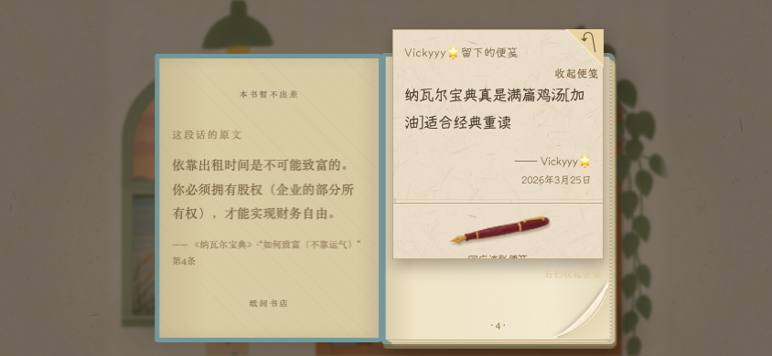

# v0.14.14 多尺寸移动适配

日期：2026-10-23。现有项目开发分支`feat/rhythm-v014`，没有创建独立Demo，没有推送或部署。

验收入口：<http://127.0.0.1:4173/?v=0.14.14&playtest=rhythm>。版本参数识别当前源码，并不是历史快照。

## 已实现

- 窄屏首次进入把主书架居中。维持书脊点击尺寸与原场景比例，两侧窗景和下方陈列可在相机内滑动查看；不缩成整间房都看得到、但书很难点击的小图。背景余量和页面本身横向溢出分别处理。
- 竖屏按可用宽度和高度计算整本书，仍为左原文/简介、右便笺。高屏增加纸页高度；横屏不再固定142px单页，844×390视口约246px单页，便笺约230px宽。
- 刘海、底部手势区与浏览器可见视口参与布局。弹窗在可见区域居中、内部内容可滚动，关闭按钮可触达。输入字体至少16px。
- 窄便笺署名移到收纸角下方，避免在纸角旁形成过窄文字列。
- 短可见区域写回应时，暂时收起同纸已读正文，保留回复输入和动作；放下笔恢复正文。使用阅读器实际高度的容器查询，兼容只缩小visualViewport而不改变布局视口的键盘情况。新建便笺的编辑纸也适应短视口。
- 布局、回应控件和视觉视口变化时同步钢笔、便笺和书页角。保留单右下角翻页、轻收纸、左右对照、所有纸可达、原文配对、原创故事与旧档；不改发现抽签、正文、回应或草稿存储格式。

主要文件：`mobile.css`、`room.js`初始相机锚点、`secrets.js`定位边界/重排接口、`siddhartha.js`重排调用、样式入口与发布白名单。版本配置为0.14.14。并行猫、地球仪、书架悬浮/排布及夹页纸角工作保留，未纳入本任务提交。

## 检查过程

| 阶段 | 结果 | 说明 |
| --- | --- | --- |
| 初轮两个项目 | 8/8 | 320竖屏和WebKit横屏基本阅读、弹窗、输入、旋转 |
| 第一轮尺寸矩阵 | 68/72 | 发现可见视口变化后立即测量的时序问题，以及写回应时裁切；修正布局同步、紧凑写字区，并按两帧布局稳定后验证 |
| 第一轮兼容 | 86/90 | 发现最窄屏钢笔居中偏移与横屏写字后页角位置不同步 |
| 中间定向 | 48/55 | 手机相关剩2项页角问题；另外5项误把仅支持touch的旧测试放到无touch桌面项目执行，属于测试选择错误，无产品修复假装通过 |
| 页角定向修正 | 2/2 | 短视口书页统一定位，不等到写字才移动；布局控件同步刷新 |
| 最终适配矩阵 | **72/72** | 2引擎×9视口×4完整用例；0失败、跳过、flaky |
| 最终兼容 | **126/126** | 两引擎320/390竖屏及844横屏：相机、笔、原文、单角翻页、18张原创纸/旧档/回应/草稿；0失败、跳过、flaky |
| 最终CDP触摸 | **4种尺寸各完整流程通过** | 320×568、390×844、412×915、844×390；页面错误均为空 |

9个尺寸为320×568、360×800、375×667、390×844、412×915、430×932、844×390、768×1024、1280×900。Android360/412项目名只表示屏幕比例，不能当作实际安卓设备验收；WebKit项目也不等于真实Safari。

CDP脚本曾错误要求横屏也必须横向平移；横屏已经容纳全幅宽度，无横向裁切。改为沿实际有裁切的轴验证平移，再完整重跑4种尺寸。保留原失败日志，不把前期失败混成最终通过。

最终198项与最终触摸检查前后，10项布局/阅读运行源码SHA256及HTTP字节一致，见[source-hashes.json](source-hashes.json)。并行场景改动存在，因此不声称全工程同一冻结快照。JS语法、JSON及差异格式检查通过。

复现：

```sh
BOOKSHOP_REPORT=evidence/mobile-fit/final-matrix.json npx playwright test -c playwright.mobile-fit.config.cjs
BOOKSHOP_REPORT=evidence/mobile-fit/final-compatibility.json npx playwright test tests/camera.spec.cjs tests/pen-entry.spec.cjs tests/quotation.spec.cjs tests/single-corner.spec.cjs tests/authored-stories.spec.cjs --project=chromium-small --project=webkit-small --project=chromium-iPhone14 --project=webkit-iPhone14 --project=chromium-landscape --project=webkit-landscape --output=evidence/mobile-fit/final-compatibility-results
node scripts/review-mobile-fit-touch.cjs
```

JSON、完整日志、失败trace与视频在本机`evidence/mobile-fit/`；关键截图、源哈希和[触摸轨迹](touch-trajectory.json)随报告提交。

## 定向触摸轨迹及边界

每种尺寸使用隔离浏览器和完整材料池，开场指定现有便笺便于原文对应核对：

1. 原生touch平移场景，音乐选择弹窗打开/关闭。
2. 从藏书抽屉拿《纳瓦尔宝典》→点封面→取便笺，核对左原文/右便笺。
3. 写回应；注入可见视口320px高、顶部偏移36px，检查输入框和“放回”可见。
4. 恢复视口→直接右下角下一页→检查未发送草稿保存→touch拖角翻页→归架。

注入的键盘高度/偏移是**模拟测试**，文字通过程序填入；触摸动作是Chromium CDP协议事件。没有新真实iPhone、Android手机、真实输入法、浏览器地址栏伸缩或十分钟盲测结论。实际设备软键盘和主观手感仍应由用户验收。

原用户标签先确认无可见未完成输入，再更新为v0.14.14。已确认实际加载`mobile.css`、build匹配、668×954窗口文档横向溢出0，翻书计数164保持；未新增标签、写便笺或清理用户存档。刷新依原规则重新选择风景/猫休息点。




