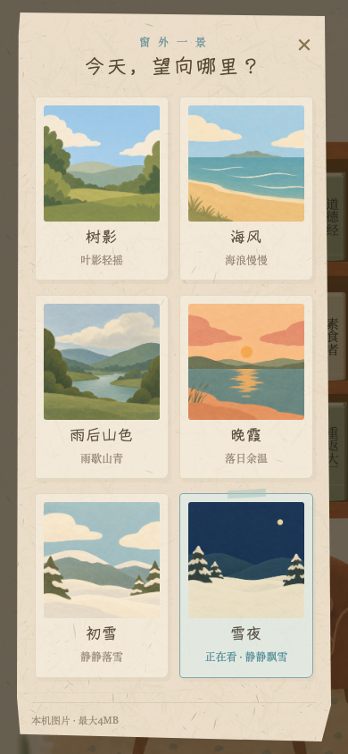

# 扁平窗景与飘雪夜色 · v0.14.15

2026-10-23。现有 `paper-bookshop-playtest`，分支 `feat/rhythm-v014`。本地入口：<http://127.0.0.1:4173/?v=0.14.15&playtest=rhythm>，点击窗户选择「雪夜」。未推送或部署生产。URL 版本参数不是历史源码快照。

## 实现

- 六张窗景统一为少量大色块、柔和边缘、轻纸感的扁平插画：树影、海风、雨后山色、晚霞、初雪、雪夜。内置 image_gen 每景独立生成一次；六张生成 PNG 原样复制进 `assets/scene/window-*-flat-v01415.png`，原文件保留。[完整提示词](../../../assets/scene/window-flat-v01415.prompts.md)。没有向生成工具发送用户照片。
- 雪夜使用深蓝天空、低矮远山、暖白积雪，22 颗不同大小、透明度、速度的 SVG 雪花缓慢落下并轻微横移。单轮 27–45 秒，负延迟错开位置，不集中从顶部出现；雪花与图片共用玻璃裁切，画在固定木框/横梁下面。
- CSS 动画，无持续粒子 JS 循环。移出相机、后台隐藏、拿起书阅读时暂停，回来续播；减少动态效果时显示静止的稀疏雪花。切换其他风景停止并淡出雪花。选景沿用原 1.2 秒淡入；手选本次到访保持，刷新仍按既有规则随机选另一景。
- 保留空白上传入口，新增「移除照片 / 撤销移除」。移除清空预览 src 与本来源的 `paperbook-window-v1.custom`，本次页面中可撤销；未统一清空所有设备/玩家的照片，未删除原始照片文件。移除当前照片回到树影，若正在看内置景则保留该景。
- 不改便笺、回应、抽取、书籍进度和旧存档结构。沿用原 window 存储键，新增场景值 `nightSnow`；旧五景值与上传数据兼容。

主要文件：`index.html`（玻璃内雪花/六景卡片/移除入口）、`room.js`（素材、移除恢复、后台与可见性）、`room.css`（飘雪与暂停/横屏选景）、六张 PNG、提示词、版本元信息、两份窗景测试。其他同时进行的书架/地球仪/声音/悬浮修改未作为本轮实现范围。

## 验证

- 替换五景与照片管理初轮 Chromium 320、WebKit 390：14/14；补充六尺寸布局与阅读回归：66/66（当时尚未加入雪夜）。
- 加入雪夜后的 Chromium/WebKit 各 320×568、390×844、844×390：77/78。唯一失败是 WebKit 390 测试把「下方书可见」误当作「窗户完全不可见」，实际窗户仍部分可见，继续飘雪符合实现。改成将相机真正移到最右/最下边界，再验证暂停；没有为通过测试修改产品行为。
- 修正测试后窗景六尺寸 54/54（0 失败/跳过/flaky），确认结果见同目录 `results.json`；覆盖六景解码和预览同源、裁切和卡片尺寸、上传/错误/移除/撤销/重载、无定时换景、实际 CSS transform 随时间变化、移出/阅读/回来续播、减少动态及后台生命周期。前轮移动阅读与模拟软键盘 24/24 已通过。
- `source-hashes.json` 保存确认轮前后相关源码与图片 SHA256、当前 HTTP 对照；确认轮期间并行墙上便笺任务修改了 `index.html`，其余 11 项保持，10 项 HTTP 与当前文件匹配。随后雪夜两引擎 390 定向复核 4/4，窗口 HTML 两个片段、index.html、room.js、room.css 及测试前后均保持，见该文件的 smoke 记录。工作区并行开发，不将本轮证据称为全工程冻结或生产验收。
- 手机尺寸、触摸、WebKit 均为 Playwright 浏览器模拟。减少动态为浏览器媒体模拟；后台为注入 `document.hidden` 并分发 visibilitychange 的生命周期测试；键盘高度为既有 visualViewport 模拟。没有验证真实 iPhone、安卓、输入法、系统后台、省电模式、长期帧率或耗电，也不是新的十分钟盲测。

本机完整过程：`evidence/window-flat/first.json`、`final.json`、`night-final.json`、`confirmed.json` 和对应日志、截图/失败 trace；最终摘要复制到本目录便于 Git 审阅。

## 实际页面操作记录

原有 IAB 标签确认无可见未完成输入后更新 v0.14.15；打开窗景纸页，点「移除自己的照片」，确认预览无 src、上传位回到「点此上传」，「撤销移除」出现。当前选中「雪夜」，关闭纸页，观测雪花 transform 在真实页面中从 `matrix(1,0,0,1,3.96298,139.877)` 变化为 `matrix(1,0,0,1,8.19202,306.219)`，动画为 running。拿书 165 次、小发现 11 次、玫瑰已获得保持。没有写字、开书、重置存档或操作线上账号；清除照片后没有再刷新原标签，保留这次页面中的撤销入口。

这是开发者的定向实际操作与视觉检查，不是物理手机验收。截图仅含清空后的状态，不保存用户照片。

相隔约 1.2 秒的实际浏览器动画帧：[A](snow-frame-a.png)、[B](snow-frame-b.png)。

## 后续验收

在物理手机上确认雪花速度/密度、横竖屏拖动画面和持续阅读的舒适度。当前原始 PNG 每张约 2MB，首次打开选景会加载可见缩略图；本轮优先保留生成原图。若后续要做体积优化，可保留原稿另派生发布素材。生产仍为原部署，本地照片状态不会自动同步到线上来源。
