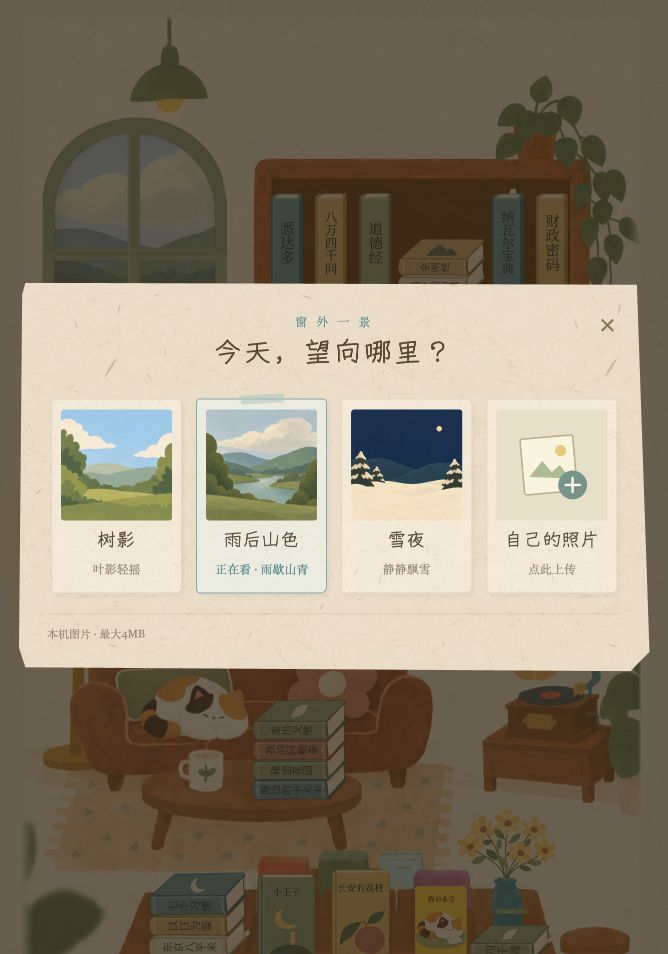

# 三景轻动态 · window-quiet-v2

2026-10-23。基于现有开发分支 v0.14.15 的局部改动；不覆盖并行开发的全局版本。入口：<http://127.0.0.1:4173/?v=0.14.15&playtest=rhythm&window=quiet-v2>。未推送或部署生产，版本参数不是历史快照。

## 效果和兼容

- 移除海风、晚霞、初雪的选景卡片、随机抽取候选及当前生成素材发布白名单。历史原图和旧证据留档，不从磁盘批量删除文件。
- 保留树影、雨后山色、雪夜，以及空白照片上传入口。横屏选景从七列改为四列；竖屏继续两列。
- 树影：两处简单叶片，11/14秒轻摆，约8度角差、1px位移。雨后山色：河面三条低透明度水纹，9–12秒微移/舒展。雪夜：保留22颗错相缓落的雪花。背景插画、木框与相机不跟着摇晃，不增加声音或付费生成。
- 全部动态在原玻璃裁切内、位于木框与横梁下方。仅当前景播放；切换、相机外、后台、阅读时暂停，减少动态时静止。新叶片/水纹复用既有雪景可见性与生命周期管理，无新增帧循环或存储键。
- 旧存档选中过已移除的三景时，只迁移风景值并沿用本次到访的随机选择，保留原上传照片；不改便笺、回应、草稿、阅读进度。自定义照片不叠叶片、水纹或雪花。

修改：`room.js` 的有效景别与旧值迁移，`index.html` 的三景卡片/叶片水纹 SVG，`room.css` 的轻动态/横屏列数，`release-manifest.json` 的当前场景说明与白名单，README、交接及三份定向测试。无需新增美术素材。

## 测试

Chromium、WebKit，各320×568、390×844、844×390，共72项：初轮66通过、6失败；6项为同一新增测试在减少动态状态下把 `animation:none` 的计算 play-state 默认值 running 误判成实际播放。切回正常动态后再验证自定义照片的「隐藏且暂停」，6个尺寸定向复核6/6。产品代码未因此修改。初轮其余66项已覆盖三景实际 transform 随时间变化、相机外与阅读暂停、未选景停止、玻璃裁切、照片上传/移除/撤销、三种旧值迁移、刷新随机与进度保持。

确认轮前后 index.html、room.js、room.css 与新测试四文件哈希一致，两段窗口 HTML 保持，三项当前 HTTP 哈希匹配。见 [结果](results.json)、[源码哈希](source-hashes.json)。本机全日志/失败trace/截图在 `evidence/window-quiet/`。并行窗口Hover测试仅把旧海风等选择夹具同步为剩余三景，保留原测试的其他内容，不把未提交的Hover实现纳入本任务。同步后触屏320/390两引擎8/8；桌面5/6，WebKit一项1.55秒悬浮采样仅采到6种窗扣姿态，未达旧测试的>8阈值，保留失败记录，WebKit单worker单独复核1/1通过，未改该动画或降低阈值；不把并发采样结果当成真机帧率结论。

浏览器手机尺寸、触摸、减少动态媒体均为模拟；后台沿用合成 visibilitychange 测试。不是物理手机、系统省电/后台、长期耗电/帧率或新十分钟盲测，也不代表全工程冻结或生产验收。

## 实际操作

原IAB标签无可见未完成输入后重新加载，打开窗景，只见「树影、雨后山色、雪夜、自己的照片」。空白上传位保持。手动选择树影观察叶片，再选择雨后山色观察水纹，computed animation 为 running、transform 随时间变化；保存实际页面截图。拿书165次、小发现11次和玫瑰状态保持，没有写字或重置存档。

三景实际浏览器帧：[叶片](original-moving.png)、[水纹](rain-moving.png)、[飘雪](nightSnow-moving.png)。手机主观速度、可见度和阅读舒适度待用户验收。
